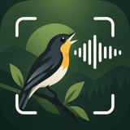
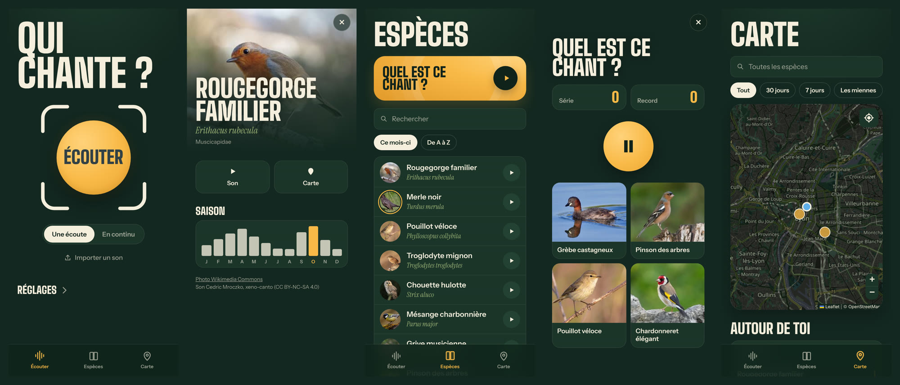

<p align="center">
  
</p>

<h1 align="center">BirdListener</h1>

<p align="center">
  <strong>Qui chante ?</strong> Tendez le téléphone, BirdListener reconnaît l'oiseau à son chant ou à son cri.<br>
  10 281 espèces du monde entier, directement dans le navigateur, même sans réseau.
</p>

<p align="center">
  <a href="https://birdlistener.vercel.app"><strong>Ouvrir l'application →</strong></a>
</p>

<p align="center">
  
</p>

---

## Ce que fait l'application

| | |
|---|---|
| **Écouter** | Un toucher, quelques secondes d'écoute : l'espèce, la certitude, chant ou cri, les autres possibilités et le moment où chaque oiseau chante dans l'enregistrement. |
| **En continu** | Pour les balades : l'app écoute sans s'arrêter et ajoute chaque espèce entendue, en direct, avec un spectrogramme défilant. |
| **Espèces** | Le guide de toutes les espèces, triées par présence dans votre pays ce mois-ci, avec photo, nom latin, saison et un chant de référence à écouter. |
| **Quel est ce chant ?** | Un jeu pour apprendre les chants des oiseaux de chez vous : quatre propositions, une série, un record. |
| **Carte** | Les observations partagées par les utilisateurs : où et quand chaque espèce a été entendue, autour de vous ou ailleurs. |
| **Mes espèces** | La collection de tout ce que vous avez entendu, et un carnet des dernières écoutes. |

L'application s'installe sur l'écran d'accueil de l'iPhone (Partager → Sur l'écran d'accueil) et fonctionne ensuite hors ligne.
La reconnaissance se fait entièrement sur le téléphone : aucun son n'est envoyé nulle part.

## Comment ça marche

```
micro ──► tranches de 3 s ──► BirdNET (empreinte de 1024 nombres) ──► classifieur BirdListener ──► espèce
                                     │                                         ▲
                                     └──── avis de BirdNET ────────────────────┤
                                                                pays + mois ───┘
```

1. **L'oreille** : [BirdNET](https://github.com/kahst/BirdNET-Analyzer) V2.4 transforme chaque tranche de 3 secondes en une empreinte numérique.
   Il tourne dans le navigateur grâce à [LiteRT.js](https://ai.google.dev/edge/litert) (WebAssembly).
2. **Le classifieur BirdListener**, entraîné ici sur **272 600 enregistrements** de [xeno-canto](https://xeno-canto.org) :
   il donne un score par tranche, et le score de l'enregistrement privilégie les meilleures tranches, ce qui lui apprend seul à repérer les passages où l'oiseau chante.
   Une seconde sortie distingue le chant du cri.
3. **La combinaison** avec l'avis de BirdNET, puis le **filtre « où et quand »** : une espèce fréquente dans votre pays à cette saison pèse un peu plus.

## Résultats

Mesurés sur 51 793 enregistrements d'auteurs que le modèle n'a jamais entendus (ni leur micro, ni leurs lieux) :

| | Bonne espèce en premier |
|---|---:|
| BirdNET seul | 54,9 % |
| BirdListener seul | 57,0 % |
| BirdListener + BirdNET | 60,7 % |
| **BirdListener + BirdNET + pays et mois** (l'application) | **66,5 %** |

Sur les espèces d'Europe, dans les conditions de l'application : **72,1 %** en premier choix, **87 %** dans les cinq premiers.
Détails : [`models/monde_v1_evaluation.json`](models/monde_v1_evaluation.json), [`models/monde_v1_contre_europe_v1.json`](models/monde_v1_contre_europe_v1.json).

## Organisation du dépôt

```
webapp/            l'application (HTML, CSS, JS sans framework), publiée sur Vercel
  reconnaissance.js  BirdNET + classifieur dans le navigateur
  app.js             écoute, fiches, guide, jeu, carnet
  carte.js           carte des observations (Leaflet)
  api/               observations partagées (Vercel Blob) et relais des chants de référence
scripts/           construction de la base, entraînement, évaluation, export web
src/               modèle et prédiction en Python (application locale app.py)
models/            modèles entraînés et résultats d'évaluation
```

## Reproduire

```bash
python -m venv .venv && .venv/bin/pip install -r requirements.txt
echo "XC_API_KEY=votre_clé" > .env                        # clé de l'API xeno-canto

.venv/bin/python scripts/fetch_metadata.py europe           # métadonnées (et africa, asia, america, australia)
.venv/bin/python scripts/select_recordings.py 120 30 europe africa asia america australia
.venv/bin/python scripts/build_species_table.py                 # noms français (liste IOC)
.venv/bin/python scripts/build_embeddings.py data/selection.csv 4 30 6   # écoute par BirdNET
.venv/bin/python scripts/build_priors.py                    # fréquences par pays et par mois
.venv/bin/python scripts/train.py monde_v1 12               # entraînement (reprend s'il est interrompu)
.venv/bin/python scripts/evaluate.py monde_v1
.venv/bin/python scripts/export_web.py monde_v1             # vers webapp/modele
```

Application locale en Python : `.venv/bin/python app.py`, puis http://localhost:5000.
Application web en local : `cd webapp && python -m http.server`.

## Vie privée

Le partage sur la carte est désactivé par défaut. S'il est activé, seuls l'espèce, la certitude, l'heure arrondie et la position arrondie à environ 1 km sont envoyées, sans aucun identifiant.

## Crédits

- **BirdNET** : K. Lisa Yang Center for Conservation Bioacoustics (Cornell Lab of Ornithology) et TU Chemnitz, licence CC BY-NC-SA 4.0.
- **Enregistrements** : les contributeurs de [xeno-canto](https://xeno-canto.org), licences Creative Commons, auteurs crédités dans l'application.
- **Photos** : Wikimedia Commons.
- **Noms français** : liste IOC.
- **Carte** : © contributeurs OpenStreetMap, Leaflet.
- **Polices** : Big Shoulders, Instrument Sans, Instrument Serif (SIL Open Font License).

Projet non commercial, comme l'exige la licence de BirdNET.
